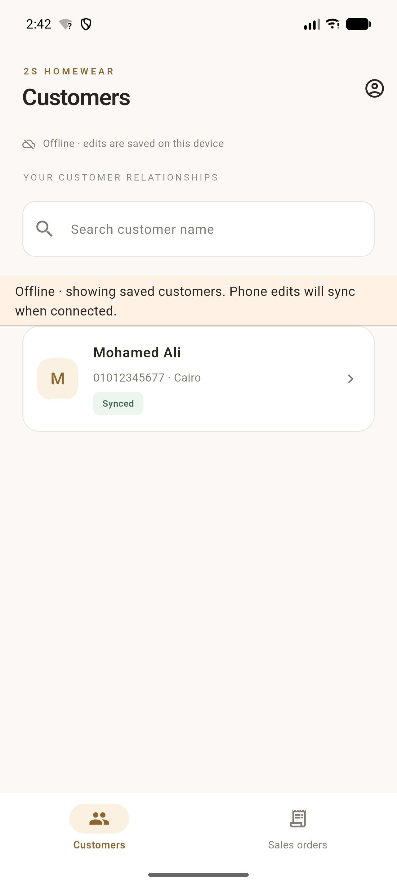
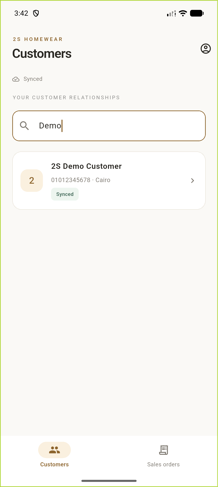
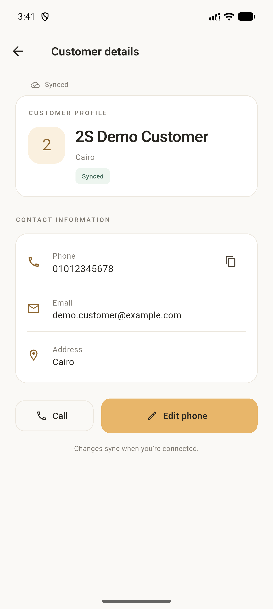
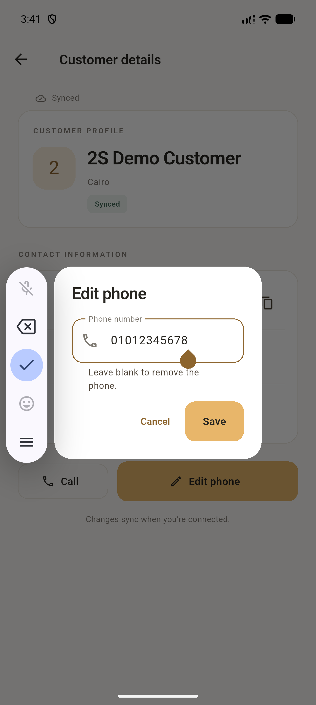
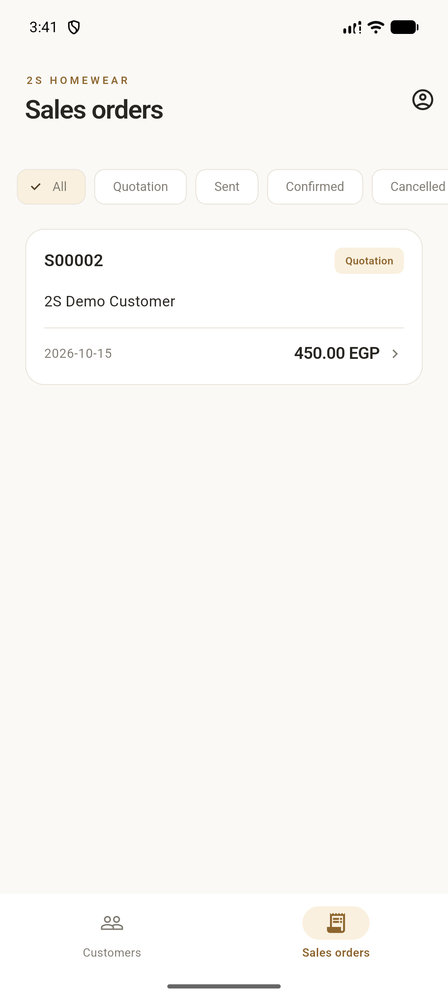
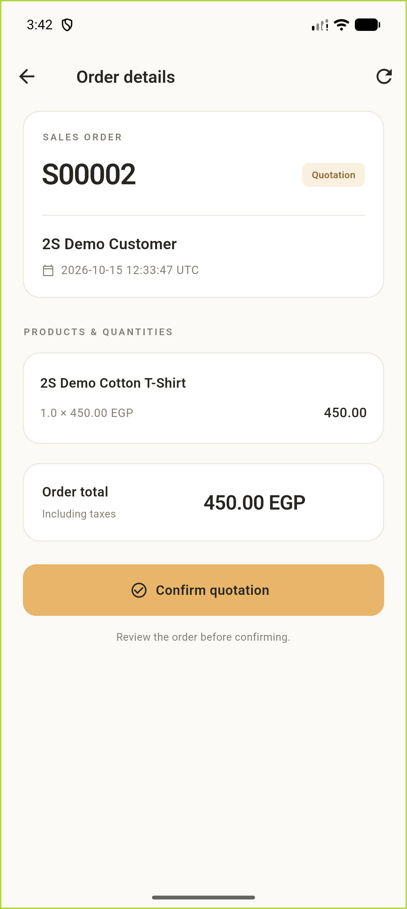

<div align="center">

# 2S Sales Hub

**A Flutter sales companion for 2S Homewear**

Manage customers, review sales orders, and keep phone updates moving—even offline.

**Flutter · Android · Real Odoo Online · v1.2.0**

[App screenshots](#app-screenshots) · [Try the app](#try-the-app) · [Run locally](#run-locally) · [Technical docs](#technical-docs)

</div>

## What you can do

| Customers | Sales orders | Offline support |
| --- | --- | --- |
| Search customers and view contact details | Browse and filter quotations and orders | View previously loaded customers |
| Edit, copy, or call a phone number | Check products, quantities, and totals | Save phone edits without a connection |
| See whether changes have synced | Confirm eligible quotations | Sync saved edits when connected again |

## App screenshots

Captured from the signed Android release. The signed-in screens use the real Odoo reviewer account and synthetic demo records.

<table>
  <tr>
    <th>Sign in</th>
    <th>Customers</th>
    <th>Customer profile</th>
  </tr>
  <tr>
    <td></td>
    <td></td>
    <td></td>
  </tr>
  <tr>
    <th>Edit phone</th>
    <th>Sales orders</th>
    <th>Order details</th>
  </tr>
  <tr>
    <td></td>
    <td></td>
    <td></td>
  </tr>
</table>

[More UI states and visual review](docs/ui_review.md)

## Try the app

1. Install **`2s-sales-hub-release.apk`** from the supplied delivery bundle on Android 7.0 or newer. Allow installation from your transfer app if Android asks.
2. Sign in with the reviewer account below. Obtain its password securely from the project owner; it is never included in this repository or APK.
3. Search for **2S Demo Customer**, open the profile, and try editing its phone.
4. Open **Sales orders → S00002** to review the demo quotation: **1 cotton T-shirt · 450 EGP**.

| Connection | Value |
| --- | --- |
| Server | `https://2s-sales-demo.odoo.com` |
| Database | `2s-sales-demo` |
| Reviewer login | `reviewer@2s-sales-demo.example` |
| Backend | Odoo Online `20.0+e` · XML-RPC over HTTPS |

The server and database are prefilled. No Docker or mock API setup is needed.

**Confirmation demo:** S00002 was left in Draft for review. Confirming it changes the order in Odoo, so do this only when ready.

**Offline demo:** Load the customer while online, disconnect, edit the synthetic phone, and restart the app. Reconnect and resume the app to sync. Sync is not guaranteed while the app is closed.

[Reviewer password retrieval and permissions](docs/reviewer_instructions.md) · [Offline test steps](docs/offline.md)

## Run locally

Built with **Flutter 3.47.2 / Dart 3.13.2**.

```sh
flutter pub get
flutter run
```

Enter credentials in the app. Never put passwords in source code or `--dart-define`.

To check and build the project:

```sh
flutter analyze
flutter test
python3 tool/prepare_release_signing.py
flutter build apk --release
```

Release output: `build/app/outputs/flutter-apk/app-release.apk`. The signing helper keeps the private assessment key outside the project; preserve that key to install future updates over the same app.

## Verified results

| Check | Result |
| --- | --- |
| Flutter analysis | Passed · no issues |
| Automated tests | Passed · 43 tests |
| Signed release APK | Built, signature checked, installed on Android emulator |
| Real reviewer access | Login, customer reads/phone writes, Sales details, and separate quotation confirmation passed |
| Offline synchronization | Real Dart + SQLite + Odoo edit/restart/reconnect test passed |
| Android UI | Signed-in screens captured and visually inspected |

The reviewer is an internal user with Sales own-document and Contacts permissions, without administrator privileges. Credentials use the OS secure store. Full Android airplane-mode/restart acceptance remains manual; Odoo trial expiry or permission changes may affect access.

## Technical docs

- [Architecture](docs/architecture.md)
- [Odoo integration](docs/odoo_integration.md)
- [Offline behavior and limitations](docs/offline.md)
- [Implementation plan](IMPLEMENTATION_PLAN.md)
- [Implementation status and evidence](IMPLEMENTATION_STATUS.md)
